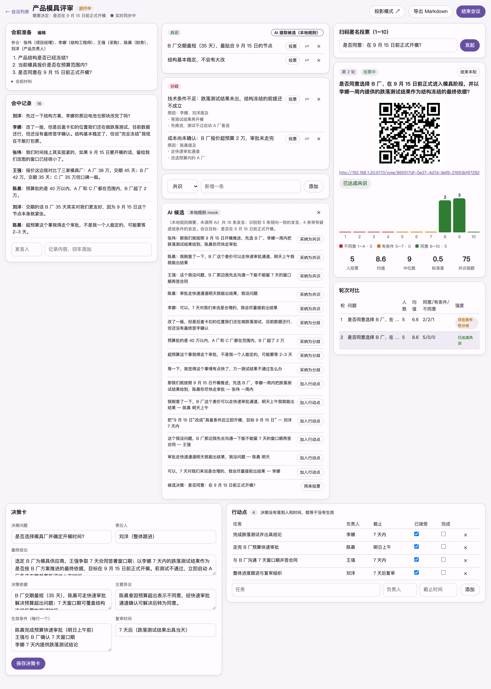
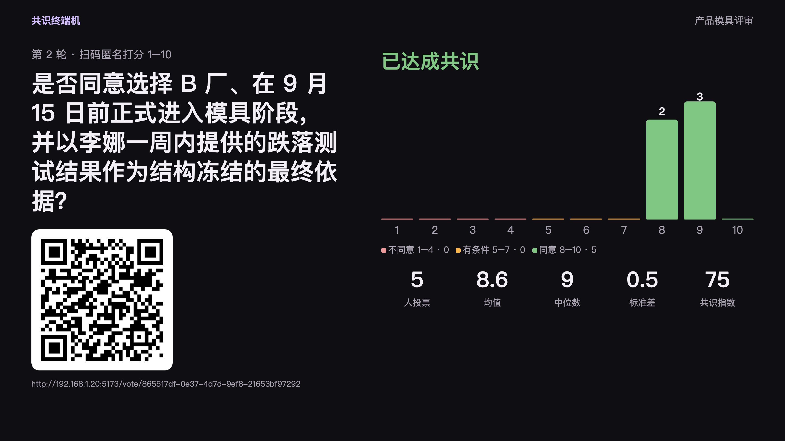
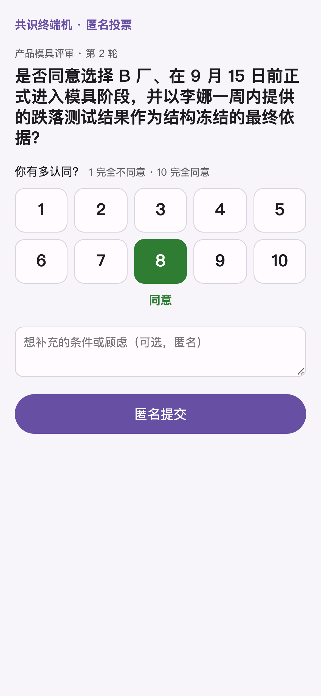
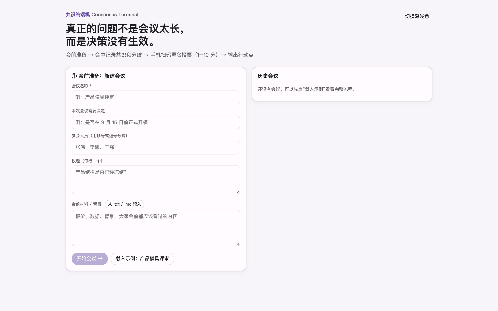

# 共识终端机 · Consensus Terminal

> 真正的问题不是会议太长，而是决策没有生效。

一场会开完，大家以为达成了一致，其实有人是“有条件同意”，有人心里不同意但没说；结论没有落到具体的人和时间，一周后又要再开一次。

共识终端机把一场决策会拆成四步，每一步都留下证据：

**会前准备 → 会中记录共识和分歧 → 手机扫码匿名投票（1–10 分）→ 输出行动点**

| 主持人屏（电脑） | 投影屏 | 手机投票 |
|---|---|---|
|  |  |  |

<details><summary>首页（会前准备）</summary>


</details>

截图使用内置示例《产品模具评审》（见下文），二维码地址为演示用的局域网地址。

## 功能

- **会前准备**：会议名称、本次需要决定的问题、参会人、议题、会前材料（可从 .txt / .md 读入）。
- **会中记录**：逐条记录发言；一键把某条发言记为“共识”或“分歧”；分歧可以写原因和几个可选观点。
- **扫码匿名投票**：对任何一个问题发起投票，生成二维码；手机打开就能打 1–10 分，不用登录。
  - 匿名但防重复：每台手机生成随机 token，服务端只存哈希；同一台手机再次提交 = 修改自己的票。
  - 分歧条目发起投票时，手机端还能选择倾向的观点。
  - 同一个问题可以投多轮，自动编号并做轮次对比。
- **实时结果**（SSE 推送）：分布直方图、均值、中位数、标准差、极差，以及“共识强度”。
- **决策卡 + 行动点**：结论、依据、主要异议、生效条件、责任人、复审时间；行动点有负责人、截止时间、是否已接受、是否完成。
- **导出 Markdown**：一键导出整场会议（议题、共识/分歧、每轮投票统计、决策卡、行动点表格 + 待办清单）。
- **投影模式**：深色大字，只显示当前问题、二维码和实时结果。
- **AI 提取候选（可选）**：从发言记录里提取候选共识、分歧、行动点。没配置密钥时使用本地规则 mock，不联网、不产生费用。

### 共识强度怎么算

1–10 分映射成三档表态：**8–10 同意，5–7 有条件同意，1–4 不同意**。

| 等级 | 条件 |
|---|---|
| 已达成共识 | 均值 ≥ 7.5、标准差 ≤ 1.5，并且没有人打 4 分及以下 |
| 明显分歧 | 标准差 > 2.5，或 ≥ 1/3 的人不同意 |
| 存在条件性分歧 | 均值 ≥ 6 |
| 共识不足 | 其它情况 |

另有一个 0–100 的共识指数：`(均值 − 1) / 9 × (1 − 标准差 / 4.5) × 100`，均值越高、意见越集中，指数越高（4.5 是 1–10 分制下标准差的最大值）。规则在 `server_stats.js`，可以按团队习惯调整。

## 快速开始

需要 Node.js 18+。

```bash
npm install
npm run dev
```

- 电脑打开 http://localhost:5173 （主持人屏）
- 点“载入示例：产品模具评审”可以直接看到完整流程
- 手机和电脑连同一个 Wi-Fi，扫主持人屏上的二维码即可投票。二维码会自动使用本机局域网 IP；如果识别错了，在 `.env` 里设置 `PUBLIC_URL`

部署 / 单端口运行：

```bash
npm run build
npm start          # http://localhost:3001 同时提供前端和 API
```

运行测试：

```bash
npm test
```

### 环境变量（都可选，见 `.env.example`）

| 变量 | 说明 | 默认 |
|---|---|---|
| `PORT` | 后端端口 | `3001` |
| `DATA_FILE` | 数据文件 | `data/db.json` |
| `PUBLIC_URL` | 二维码使用的地址 | 自动检测局域网 IP |
| `AI_API_KEY` | 打开真实 AI 提取（OpenAI 兼容接口） | 不设置 = 本地 mock |
| `AI_BASE_URL` / `AI_MODEL` | 模型接口地址 / 模型名 | `https://api.deepseek.com` / `deepseek-chat` |

密钥只从环境变量读取，不写进代码、前端或数据文件。`npm run dev` 不会自动读取 `.env`，需要时可以 `export AI_API_KEY=...` 后再启动。

## 架构

```
浏览器（主持人屏 / 投影屏）  ──SSE 实时快照──┐
手机（投票页）  ──POST 投票──────────────────┤
                                              ▼
                     Express API (server_app.js)
                     ├─ server_store.js     JSON 文件持久化（原子写入）
                     ├─ server_stats.js     均值 / 中位数 / 标准差 / 共识强度
                     ├─ server_markdown.js  会议 → Markdown 导出
                     ├─ server_ai.js        可选 AI 提取，默认本地 mock
                     └─ server_demo.js      示例会议《产品模具评审》
```

```
（所有文件都在同一层，没有子文件夹，方便直接在 GitHub 网页上传）
server.js              后端入口
server_app.js          全部接口 + SSE 实时推送
server_store.js        JSON 文件持久化（运行时自动创建 data/ 目录，已 gitignore）
server_stats.js        统计与共识强度
server_markdown.js     Markdown 导出
server_ai.js           可选 AI 提取，默认本地 mock
server_demo.js         示例会议《产品模具评审》
index.html  main.js  App.vue  router.js  api.js  style.css   前端入口
Home.vue               会前准备
Meeting.vue            主持人屏
Present.vue            投影屏
Vote.vue               手机投票页
ScoreChart.vue         分布图与统计
api.test.js  stats.test.js        测试（vitest + supertest）
screenshot_*.png       截图
test-case-1-产品模具评审.md       测试案例原文
```

主要接口：

| 方法 | 路径 | 说明 |
|---|---|---|
| POST | `/api/meetings` | 新建会议 |
| GET | `/api/meetings/:id` | 会议快照（含每轮投票的统计，不含单张选票） |
| GET | `/api/meetings/:id/events` | SSE 实时推送 |
| POST | `/api/meetings/:id/notes` | 记录发言 |
| POST | `/api/meetings/:id/items` | 新增共识 / 分歧 |
| POST | `/api/meetings/:id/sessions` | 发起投票，返回二维码和加入链接 |
| GET | `/api/sessions/:sid` | 手机端读取题目 |
| POST | `/api/sessions/:sid/votes` | 匿名投票 `{ score: 1-10, choice?, comment?, voterToken? }` |
| GET | `/api/sessions/:sid/results` | 聚合结果 |
| POST | `/api/meetings/:id/actions` | 新增行动点 |
| PATCH | `/api/meetings/:id` | 更新会前信息 / 决策卡 / 状态 |
| GET | `/api/meetings/:id/export.md` | 导出 Markdown |
| POST | `/api/meetings/:id/ai/extract` | AI 提取候选（可选） |
| POST | `/api/demo` | 载入示例会议 |

## 测试案例：产品模具评审

原文见 [test-case-1-产品模具评审.md](test-case-1-产品模具评审.md)。

- **会议**：5 人（项目经理、结构工程师、采购、财务、产品负责人），决定“是否在 9 月 15 日前正式开模”。
- **分歧**：跌落测试结果未出，结构冻结的前提不成立（2 人提及）；B 厂报价超预算 2 万，审批未走完（1 人提及）。
- **首轮确认**：同意 2、有条件同意 2、不同意 1 → 系统判断“存在条件性分歧”。
- **继续讨论**：财务找到快速审批通道；把“9 月 15 日开模”改成“具备条件后立即开模，目标 9 月 15 日”，测试不过就启动 A 厂备选。
- **二轮确认**：5 人同意 → “已达成共识”。
- **输出**：决策卡（结论、依据、主要异议、3 条生效条件、责任人、复审时间）+ 4 个行动点，每个都有负责人和截止时间。

案例原文只记录了三档表态，没有具体分数。示例和测试里把它映射成 1–10 分的示意值（同意 8/9，有条件同意 6，不同意 3）：

| 轮次 | 分数 | 均值 | 中位数 | 标准差 | 同意 / 有条件 / 不同意 | 共识强度 |
|---|---|---|---|---|---|---|
| 1 | 6, 9, 6, 9, 3 | 6.6 | 6 | 2.2 | 2 / 2 / 1 | 存在条件性分歧 |
| 2 | 9, 9, 8, 9, 8 | 8.6 | 9 | 0.5 | 5 / 0 / 0 | 已达成共识（指数 75） |

`api.test.js` 按这个案例跑完整流程：创建会议 → 记录发言 → 标记共识 / 分歧 → 发起投票并生成二维码 → 两轮匿名打分 → 校验聚合结果 → 录入决策卡和行动点 → 导出 Markdown → 重启后数据仍在。

## 来历

这个仓库整理自 2026 年 6–9 月的几版原型：一版 Express + 原生 HTML，两版 Vue + Vite（早期打包上传在 [SSShichuanyi/-1.0](https://github.com/SSShichuanyi/-1.0)）。这一版把它们合成一个应用，补上了持久化、实时同步、匿名防重复、统计与共识强度、决策卡、Markdown 导出和自动化测试。

---

## English

**Consensus Terminal** — *the real problem isn't that meetings are too long; it's that decisions don't take effect.*

A small self-hosted tool for decision meetings: prepare the agenda and pre-read → capture notes and split them into **consensus** vs **disagreement** → participants scan a QR code and score the proposal **1–10 anonymously** on their phones → live aggregation (mean, median, standard deviation, spread, and a *consensus strength* level/index) → a decision card and **action items (owner, deadline)** exported as Markdown.

- Stack: Node + Express (JSON-file store, SSE for real-time) and Vue 3 + Vite (facilitator screen, projector view, mobile voting page).
- Run: `npm install && npm run dev`, open http://localhost:5173, click “载入示例” to load the demo meeting. Phones on the same Wi-Fi can scan the QR code.
- Test: `npm test` (vitest + supertest, end-to-end: create meeting → vote → aggregate → export).
- AI extraction is optional: set `AI_API_KEY` (any OpenAI-compatible endpoint); otherwise a local rule-based mock is used. No keys are stored in code.

License: MIT
